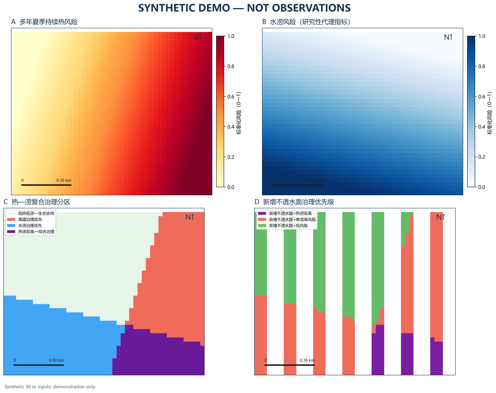
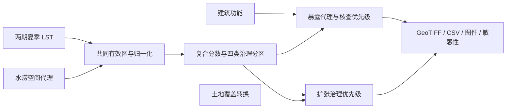

# 热水共治 · Changchun Heat-Water Resilience

用遥感栅格与建筑功能数据，识别城市热—涝复合空间筛查优先区。
本项目提供可复现的处理链、参数敏感性分析和数据完整性校验。

**版本：0.1.0，本地发布候选。** 长春真实数据成果保留在本地；
公开示例为可自动生成的模拟数据。水涝指数是研究性代理指标。



上图为模拟案例，不代表长春观测结果。

## 回答什么问题

- 哪些位置在两个夏季合成窗口中具有较高的相对地表热分数？
- 热、水涝代理分别偏高或同时偏高的位置在哪里？
- 新增不透水面与居住、教育、医疗、公共服务建筑如何影响核查排序？

## 快速开始

交互网页已提供：在浏览器打开 website/index.html 即可离线预览模拟案例。
它支持六种地图图层、参数调整和结果导出。真实长春成果的本地预览与
数据导出步骤见 [网页使用说明](website/README.md)。

先运行不需要 GIS 软件的测试：

```sh
python -m pip install -e .
python -m unittest discover -s tests -v
```

完整地理处理环境与模拟案例：

```sh
conda env create -f environment.yml
conda activate heatwater
python -m scripts.synthetic_case --directory demo
python -m scripts.run_pipeline --config demo/config.json
python -m scripts.validate_outputs --config demo/config.json
```

也支持已有 QGIS 的 Python 环境。生成器要求 demo/data 为空；
完整配置、安装后 CLI 和真实数据步骤见 [复现指南](docs/reproducibility.md)。

## 分析流程



默认热/涝权重为 0.55/0.45，四类分区的分量阈值为 0.67。
权重控制连续分数；四类分区由热、水分量各自的阈值决定。
参数可配置，所有默认值沿用现有分析逻辑。

## 项目结构

```text
config/example.json          可移植配置模板
scripts/                     核心逻辑、GIS处理、制图、校验、模拟数据生成
tests/                       纯 NumPy 测试与可选 GDAL 集成测试
data/README.md               输入契约和获取说明
auxiliary/                   公式与类别编码
docs/                        方法、架构、复现、数据字典和局限性
.github/                     自动测试与问题模板
```

安装后使用 heatwater、heatwater-demo、heatwater-validate 命令。
源代码包 scripts 在安装时映射为 heatwater；不复制算法代码。

## 使用真实数据

复制 config/example.json 为 config/local.json，填写输入路径与输出目录。
project_root 相对配置文件解析，输入输出路径相对 project_root 解析。
完整流程需要早期 LST、近期 LST、转换、水涝代理和建筑功能数据。
四环案例要求 30 m、EPSG:32651；晚期 LST 与转换必须与早期网格一致。

```sh
python -m scripts.run_pipeline --config config/local.json
```

每次运行生成十个最终栅格、两张统计表、输入清单、四张图、运行元数据、
两项敏感性成果及输出校验清单。输出清单记录相对路径、SHA-256 与大小。
重复运行会替换指定目录中的同名生成文件。

## 科学解释与数据许可

长春案例使用两期合成窗口，而非逐年温度序列。LST 是地表温度；
水涝层未使用独立积水观测进行校准；建筑功能并不等于人口数量。
因此结果用于候选区域筛查和进一步核查，不提供工程级预测精度。

代码和模拟数据采用 [MIT](LICENSE)。第三方数据与真实数据衍生图件
按各自来源许可管理；[数据许可说明](DATA_LICENSE.md)列明待核验项。
真实影像、建筑 GPKG、比赛提交包及本机配置均不进入公开仓库。

## 文档与贡献

- [方法与参数](docs/methods.md)
- [数据字典](docs/data_dictionary.md)
- [架构](docs/architecture.md)
- [科学边界](docs/limitations.md)
- [后续研究](docs/roadmap.md)
- [发布步骤](docs/publishing.md)
- [贡献指南](CONTRIBUTING.md)

软件引用信息见 CITATION.cff；使用真实数据时应另行引用各来源。
GitHub CI 配置已提供，其线上执行状态以实际仓库运行结果为准。
