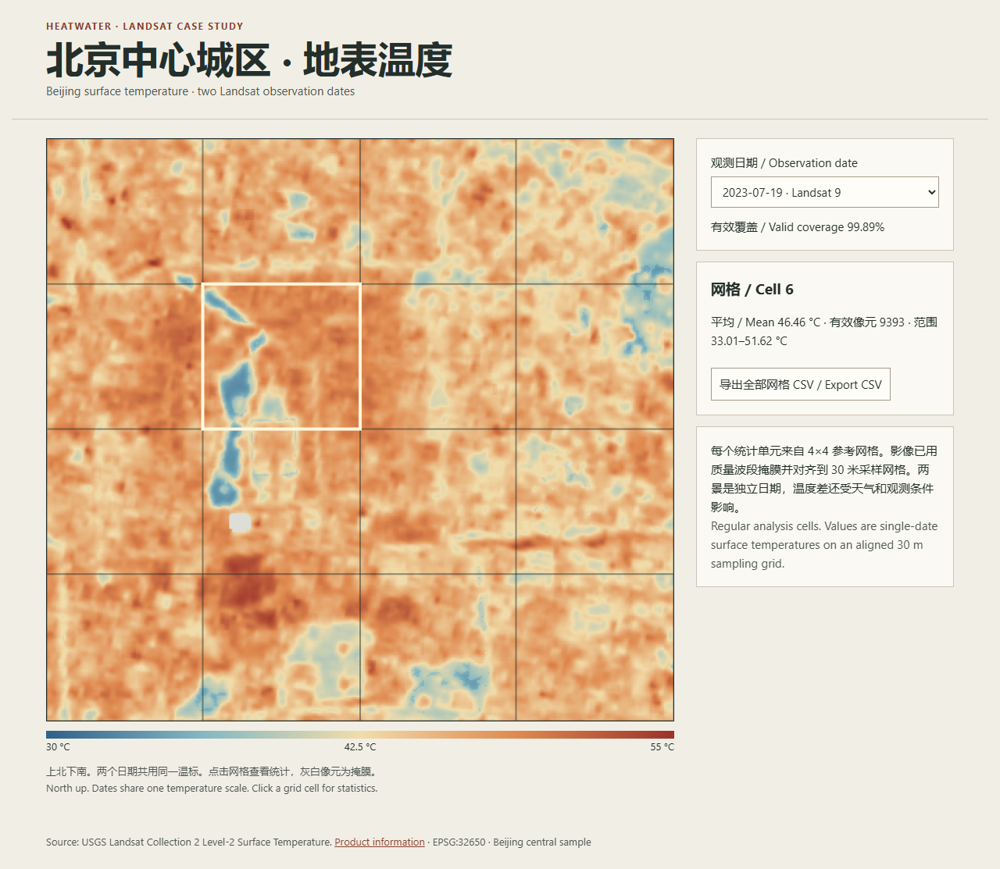

# 北京中心城区 · Landsat 地表温度

[返回城市案例](../README.md)

北京样例把两景真实 Landsat 温度影像接入 Heatwater。下载后用浏览器打开，切换日期、点击 16 个统计格，即可查看温度范围并导出 CSV。[下载北京离线地图](https://github.com/Cola2233/heatwater/releases/download/v0.1.0/heatwater-beijing-temperature.html)

| 项目 | 内容 |
|---|---|
| 样区 | 116.34–116.48°E、39.87–39.97°N |
| 观测日期 | 2014-08-19、2023-07-19 |
| 坐标系与网格 | EPSG:32650，30 米采样，16 个规则统计格 |
| 实现范围 | 单景地表温度查看、像元统计与导出 |

完整场景编号、质量掩膜、USGS 署名和构建命令见[北京样例方法](../../docs/beijing-temperature-demo.md)。
