# Architecture

```mermaid
flowchart LR
  A[JSON config and input files] --> B[Preflight: paths, grid, units, vector fields]
  B --> C[Align water proxy to LST reference]
  C --> D[Percentile normalization]
  D --> E[Heat-water score and component quadrants]
  E --> F[Expansion and building-function exposure]
  F --> G[GeoTIFF, CSV, figures and sensitivity]
  G --> H[Checksums and output validation]
```

- scripts/project_config.py: portable path and parameter contract.
- scripts/risk_logic.py: NumPy formulas independent of GIS software.
- scripts/build_heat_water_resilience.py: GDAL/OGR processing.
- scripts/make_figures.py: map rendering; optional context vectors.
- scripts/provenance.py and validate_outputs.py: integrity and grid checks.
- scripts/run_pipeline.py: single orchestration entry.
- scripts/synthetic_case.py: generated demonstration inputs, never observations.
- scripts/sensitivity_analysis.py: score and classification parameter sweeps.
- scripts/export_web_data.py: exports analytical rasters to public synthetic or ignored private browser data.
- scripts/build_single_html.py: embeds local web assets; defaults to the public synthetic entry.
- scripts/blocks.py: optional road partition, raster-center ownership, summaries and topology diagnostics.
- website/core.js: Float32 numerical counterpart of the Python screening rules.
- website/charts.js and app.js: linked charts, canvas map, parameters and downloads.
- website/tests/public-browser-check.cjs: offline source/bundle checks without private data.
- website/blocks-core.js and blocks.js: per-block statistical parity, selection, choropleths and filtered CSV.

Source execution uses the scripts package. Installation exposes the same files
as the heatwater package and the heatwater CLI; formulas are not duplicated.

[City case pages](../cases/README.md) describe each study area, inputs, supported
analyses, and delivery status. The workflow still uses Changchun-specific
defaults for grid and period metadata. Beijing uses the standalone temperature
exporter. Future case configurations can supply metadata as the corresponding
workflow steps become reusable.

The Python wheel contains processing modules and CLI, not the website or
reference datasets. Clone/download the repository to use its static web assets;
heatwater-bundle and heatwater-web-export accept paths to that checkout.
The web UI needs no build step or runtime npm dependencies. Playwright is a
locked optional development dependency, used only in browser checks.

build_submission_doc.py and build_design_directions.py are historical authoring
utilities, not supported pipeline or onboarding entry points. They require local
project materials and are not used by the public demo or processing CI.
