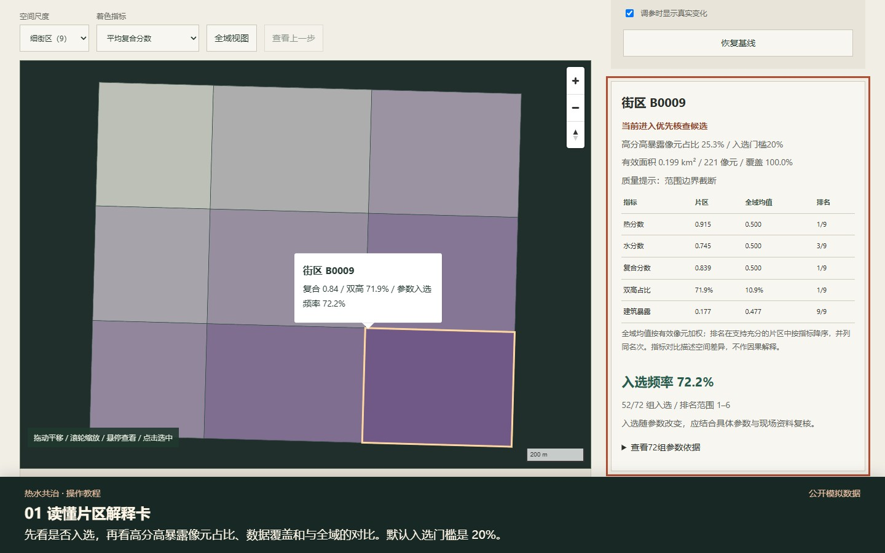

# 热水共治入门教程

## 为什么做这个

热环境图能告诉我们哪里偏热，水涝代理图能帮助识别哪里更容易出现积水相关条件。两张图分开看，很难判断哪些片区同时需要留意热、水与建筑暴露，也难以看出优先顺序是否随权重和阈值变化。

热水共治把这些信息放在一张地图上。它帮助研究者和规划分析人员先找候选片区，再查看每个片区的筛选依据，最后把清单带去和独立观测或现场记录对照。长春四环是本地研究案例。公开演示使用九个模拟片区，操作流程与真实数据版相同。

## 打开演示

下载并解压 `heatwater-quickstart-zh.zip`，包内有地图、图文教程和视频。也可以单独下载 `heatwater-research-demo.html`。用 Edge 或 Chrome 打开 HTML，离线即可操作，无需安装软件或导入数据。如果在 GitHub 或 Codex 中看到代码，请先保存文件，再从浏览器打开。[v0.1.0 发布页](https://github.com/Cola2233/heatwater/releases/tag/v0.1.0)

同一 Release 的 `heatwater-walkthrough-zh.mp4` 是 70 秒中文字幕演示。

长春四环真实数据版用于本地研究。若要计算自己的城市或研究区，先按[数据输入说明](../data/README.md)准备数据，再按[复现指南](reproducibility.md)运行处理与地图导出。

## 跟着做一遍

| 视频时间 | 操作 | 观察什么 |
|---|---|---|
| 00:09 | 点击模拟地图右下角的街区 B0009 | 地图高亮所选片区。往右侧下方看解释卡，先读当前是否入选，再看高分高暴露像元占比、数据质量和指标排名。 |
| 00:25 | 把热分量权重从 55% 拉到 70% | 勾选「调参时显示真实变化」时，橙色表示增加，青色表示减少。点「查看上一步」可对照此前地图。热权重改变的是复合分数，因此顶部的热涝分量双高面积可能保持不变。 |
| 00:37 | 点「恢复基线」，再点「查看入选频率地图」 | 颜色显示每个片区在 72 组参数下的入选比例。展开所选片区的「查看72组参数依据」，可查阅逐组结果。 |
| 00:54 | 在页面下方的核查清单里选「当前参数入选」，再点「导出筛选清单CSV」 | 地图与清单同步筛选。CSV 包含全部匹配片区及其指标、数据覆盖、筛查规则和参数。 |

演示中，B0009 在默认参数下入选，在 72 组参数中入选 52 次，频率为 72.2%。筛选「入选频率≥80%」时，当前模拟案例会显示空清单，可以切回「当前参数入选」继续体验导出。

## 怎么读这些指标

- **双高**指同一像元的热、水分量分别达到高值阈值。页面顶部显示满足该条件的总面积。
- **候选片区**看的是另一条规则。默认要求片区至少有 9 个有效像元、有效覆盖达到 80%，且复合分数达到阈值、建筑暴露指数达到 0.6 的像元合计占有效像元至少 20%。这是用于选出现场核查对象的探索性规则。
- **入选频率**描述结果在所测试权重和阈值下的稳定性。水涝层是筛查代理指标，建筑暴露是建筑功能相关指数。用清单安排复核时，应结合独立观测和现场信息。

详细规则和长春真实数据的分区方法见 [片区解释与参数稳定性](explanation-stability.md) 和 [主干路片区说明](planning-blocks.md)。
